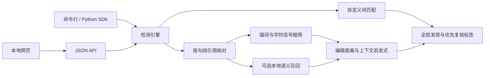

# 架构与能力边界

默认规则模式无第三方运行依赖。`algorithms/` 保留四代方法的核心实现：V1 字符重叠与锚定编辑距离，V2 四信号 OR 粗筛，V3 锚内字面与锚外上下文，V4 本地句向量召回。V1–V3 的批量预测使用 Python 列表，字符余弦使用标准库计数。应用默认使用 V3；V1/V2 保留供方法比较。

应用层增加了可配置词库、逐句处理、关键词和引用发现的统一输出，并在多条命中时优先保留复核标签。V4 只在用户明确选择语义模式时加载，模型异常会中止该次检测。

NFKC 和大小写处理按原字符展开，保留原文位置映射。关键词规则可选择去除非字母数字字符以召回分隔符变体；这也可能把原本独立的字词拼接后误报。默认短句用于方法演示，不是一份法律、平台政策或内容审核标准。

引用分类使用人工启发式。上下文扩展、否定、讽刺、引述中再引述、长文档跨句关系、组合字符的 Unicode 规范化、未登录词及完全同义改写均存在边界。V3 的上下文规则可能将同句中有差错的引用归入标签 2；标签 2 始终只表示规则命中，不代表正确或安全。

语义相似度不是校准过的风险概率；阈值只是实验性配置。语义模式会增加召回，也可能增加无关句误报。没有开展独立真实业务数据评估，不对准确率或漏报率作通用承诺。

工作台是单机工具。它不包含云端词库同步、数据库、账号系统、生产审核工作流或公网部署设施。应用不自动保留用户输入；显式导出的 JSON 包含原文。
